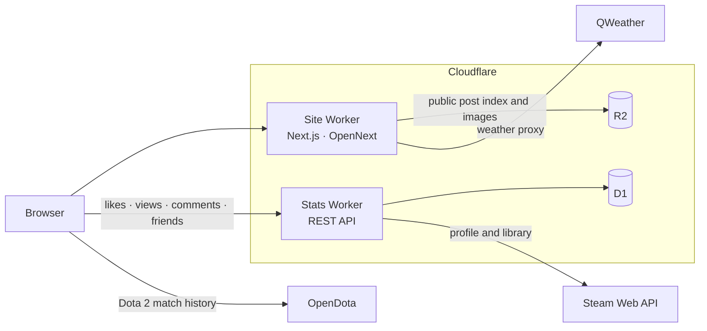

# Pixel Blog

**English** · [简体中文](./README.zh-CN.md)

A personal website built with pixels as its skeleton and glass as its skin — writing, photography, and a few game profiles, designed end to end instead of assembled from a theme.

[Live site](https://cwa1e.top) · [Gallery](https://cwa1e.top/gallery) · [About](https://cwa1e.top/about)

[](https://nextjs.org)
[](https://react.dev)
[](https://www.typescriptlang.org)
[](https://tailwindcss.com)
[](https://workers.cloudflare.com)


## Contents

- [Overview](#overview)
- [Design](#design)
- [Screenshots](#screenshots)
- [Tech stack](#tech-stack)
- [Architecture](#architecture)
- [Project structure](#project-structure)
- [Getting started](#getting-started)
- [Scripts](#scripts)
- [Configuration](#configuration)
- [Deployment](#deployment)
- [Known limitations](#known-limitations)
- [License](#license)
- [Acknowledgements](#acknowledgements)

## Overview

Pixel Blog is the personal site of CarlosWhite (李白的白). It collects three kinds of content — written notes, photographs, and game profiles — and presents them with one visual system: pixel-grid structure, liquid-glass surfaces, and a backdrop that follows real time and real weather.

Everything here is hand-built: routing, motion specs, the photo viewer, the terminal mode, the statistics service. There is no page builder, no theme, and no CMS UI beyond a local-only admin used for uploading.

## Design

**Pixels are structure, not a filter.** Right angles, stepped corner marks, and monospaced labels are used as layout units. Rounded corners are reserved for surfaces that should feel soft.

**Glass is the skin.** Cards are translucent layers — 22px blur, 190% saturation, a 1px highlight edge — so a moving background never turns them into stickers on wallpaper.

**Light comes first.** The backdrop tracks the observer's sun and moon position, the lunar phase, and wind force, then layers rain, snow, fog, or storm on top. Content stays in the foreground; weather stays environment.

**Motion explains space.** A card opens into a panel from its own rectangle — 300ms out, 250ms back, content revealed after 120ms — and every card-to-panel transition reuses the same component (`PixelBloom`).

**Two readings, one skeleton.** The standard and terminal modes share routes, data, and the app shell. The terminal is not a theme; it is another way to read the same content.

## Screenshots

| Standard mode | Terminal mode |
| --- | --- |
|  |  |

| Gallery | Photo viewer |
| --- | --- |
|  |  |


## Tech stack

| Layer | Choice |
| --- | --- |
| Framework | Next.js 16 (App Router), React 19, TypeScript |
| Styling | Tailwind CSS 3, custom liquid-glass and pixel utilities |
| Motion | CSS transitions plus a single shared expansion component |
| Media | Swiper (photo viewer), Canvas rendering, sharp / EXIF / HEIC tooling |
| Maps | Mapbox GL |
| Hosting | Cloudflare Workers via OpenNext |
| Data | Cloudflare D1 (likes, views, comments, friend links), R2 (posts, images) |
| Third-party | QWeather, Steam Web API, OpenDota, Simple Icons |

## Architecture



Notes:

- The site Worker renders pages and proxies weather requests. Public content (post index, images) is read from R2 through a public domain, so the browser needs no credentials.
- The stats Worker owns all writes to D1 and aggregates Steam data behind a 10-minute edge cache.
- Dota 2 data is fetched in the browser: OpenDota rate-limits Cloudflare egress IPs, so a Worker proxy is not viable.

## Project structure

```
pixel-blog/
├─ app/                   # App Router routes, layouts, metadata
│  ├─ (site)/             # public pages sharing the app shell
│  ├─ api/weather/        # QWeather proxy
│  └─ admin/              # local-only admin (excluded from production)
├─ src/
│  ├─ components/         # shell, cards, modals, gallery, weather
│  ├─ lib/                # data access, formatting, engagement helpers
│  ├─ data/               # gallery metadata, generated weather snapshot
│  ├─ hooks/ utils/ types/
│  └─ index.css           # design tokens and motion utilities
├─ worker/                # stats Worker (Cloudflare + D1) and schema
├─ public/                # static assets, project logos
├─ docs/screenshots/      # README images
└─ scripts/               # weather fetch, gallery upload, IndexNow
```

## Getting started

Requirements: **Node.js 22 or newer**.

```bash
git clone https://github.com/LiBaiQiYu/pixel-blog.git
cd pixel-blog
npm install
cp .env.example .env.local   # fill in what you need
npm run dev                  # http://localhost:5173
```

The site runs without any credentials for browsing. The local admin (photo upload, post editing) needs the R2 variables; the weather card needs `QWEATHER_*`.

## Scripts

| Command | Description |
| --- | --- |
| `npm run dev` | Development server on port 5173 |
| `npm run build` | Production build with type checking |
| `npm start` | Serve the production build locally |
| `npm run cf:build` | OpenNext build for Cloudflare |
| `npm run cf:preview` | Build and preview on the Workers runtime |
| `npm run cf:deploy` | Build and deploy the site Worker |
| `npm run stats:deploy` | Deploy the stats Worker |
| `npm run stats:migrate:reactions` | Apply the photo reactions migration |
| `npm run stats:migrate:friends` | Apply the friend links migration |
| `npm run gallery:meta` | Regenerate gallery metadata |
| `npm run gallery:upload` | Upload gallery assets to R2 |
| `npm run seo:indexnow` | Submit the sitemap to IndexNow |

## Configuration

Copy `.env.example` to `.env.local`. Names only — never commit values.

| Variable | Scope | Purpose |
| --- | --- | --- |
| `QWEATHER_API_HOST` `QWEATHER_KID` `QWEATHER_PROJECT_ID` `QWEATHER_DEVELOPER_ID` `QWEATHER_PRIVATE_KEY_PATH` `QWEATHER_LAT` `QWEATHER_LON` `QWEATHER_CITY` `QWEATHER_TIMEZONE` | server | Weather API and default location |
| `NEXT_PUBLIC_MAPBOX_ACCESS_TOKEN` | build | Gallery map |
| `NEXT_PUBLIC_STATS_API_URL` | build | Stats API base URL |
| `NEXT_PUBLIC_BLOG_IMAGE_BASE_URL` | build | Public image base |
| `NEXT_PUBLIC_STEAM_ID` | build | SteamID64 used to derive the Dota account id |
| `R2_ACCOUNT_ID` `R2_BUCKET` `R2_ACCESS_KEY_ID` `R2_SECRET_ACCESS_KEY` `R2_PREFIX` | local Node | Admin uploads and gallery scripts |
| `R2_BLOG_PREFIX` | server | Blog object prefix inside the bucket |
| `ADMIN_DEV_TOKEN` | dev | Protects the local admin when exposed over LAN |
| `FRIENDS_ADMIN_TOKEN` | Worker secret | Friend review endpoints |
| `DEV_ALLOWED_ORIGINS` | dev | Extra origins for LAN or tunnel access |

## Deployment

The site and the statistics service are separate Workers.

```bash
# Stats Worker: D1 migrations first, then the secret and the deploy
npx wrangler secret put STEAM_API_KEY --config worker/wrangler.toml
npm run stats:migrate:reactions
npm run stats:migrate:friends
npm run stats:deploy

# Site Worker
npm run cf:deploy
```

- `worker/wrangler.toml` holds the custom domain route for `stats.cwa1e.top`. Removing it makes Wrangler drop the domain on the next deploy.
- `STEAM_API_KEY` is a Worker secret; it is never part of the client bundle. `STEAM_ID` is a plain variable in the same file.
- The site Worker needs its build-time variables (`NEXT_PUBLIC_*`) configured in the Cloudflare build environment, not only at runtime.

## Known limitations

- **No online admin or authentication.** The admin is local-only and requires Node-only image tooling; production returns 404 for `/admin`.
- **No automated test suite.** Verification is a production build plus manual browser checks.
- **Steam badges and showcases** exist only on community profile pages, not in the Web API, so the profile panel shows aggregate counts.
- **Dota 2 data** must stay client-side because OpenDota rejects Cloudflare Worker egress IPs with `429`.
- Netlify and Vite configuration files remain from an earlier deployment target and are not used.

## License

Article text and photographs are © CarlosWhite. The source code is published for reference; no open-source license is granted.

## Acknowledgements

- Gallery concept and parts of the design language inspired by [ChronoFrame](https://github.com/HoshinoSuzumi/chronoframe).
- Weather data by [QWeather](https://www.qweather.com).
- Game data from the [Steam Web API](https://steamcommunity.com/dev) and [OpenDota](https://www.opendota.com).
- Technology icons from [Simple Icons](https://simpleicons.org) (CC0).
