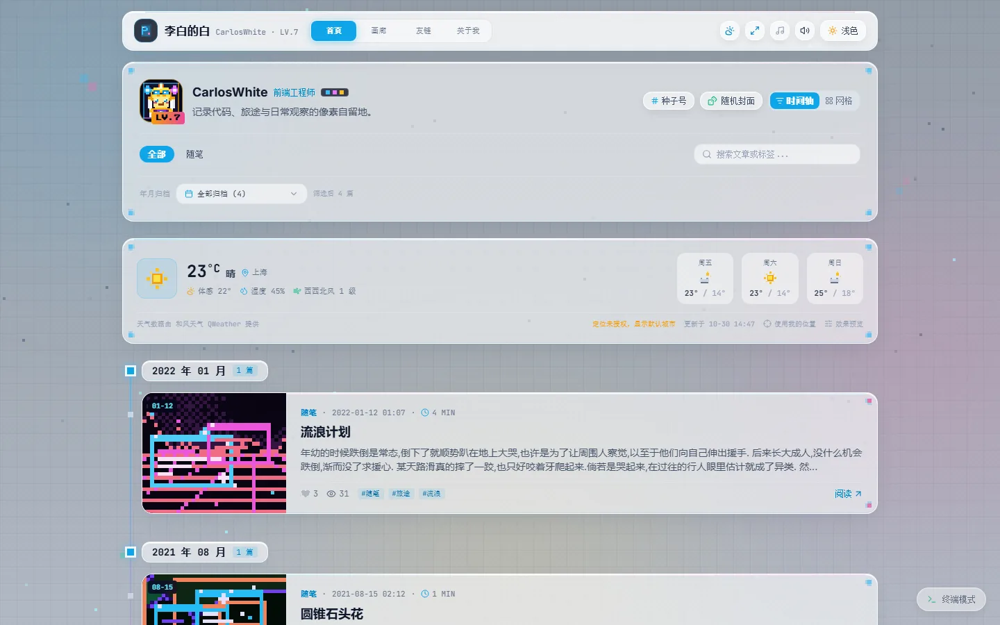
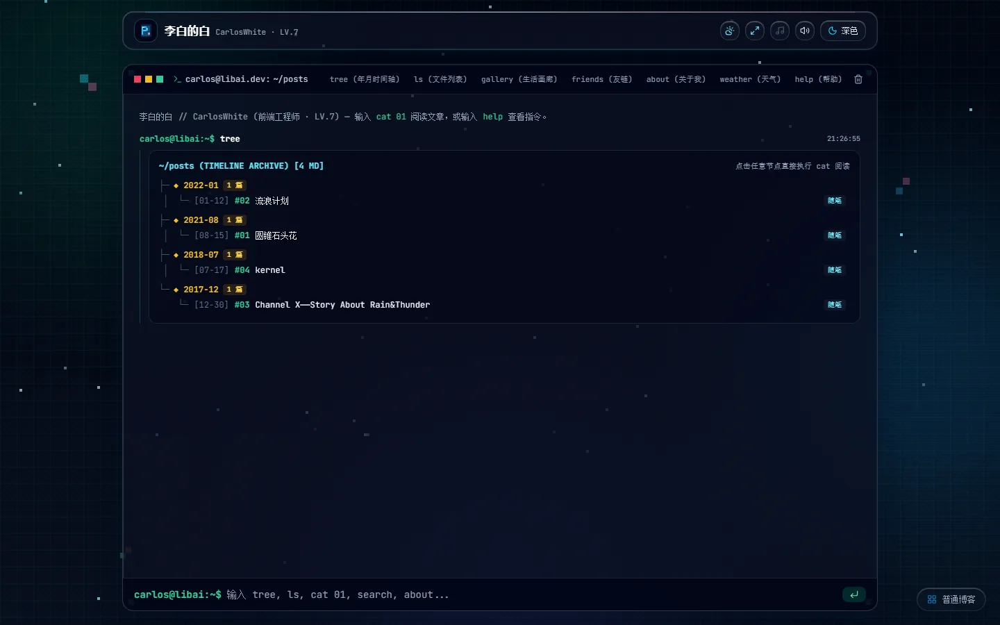
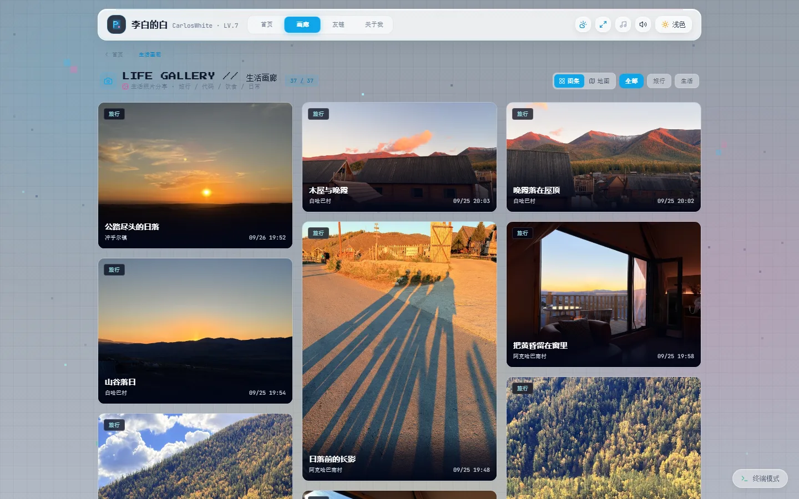

<h1 align="center">李白的白</h1>

<p align="center"><strong>一个用像素当骨架、用玻璃当皮肤的个人站点</strong></p>

<p align="center"><a href="https://cwa1e.top">cwa1e.top</a> · 随笔 / 画廊 / 友链 / 关于</p>



## 出发点

这是一个人的网站，不是一套主题。

写作、摄影、几款游戏，还有一个不想被模板定义的自我介绍。所以这里的每个界面都是从一张空白画布开始画的——导航怎么滑、卡片怎么浮起来、点开一张照片时镜头怎么动，都当作设计问题来回答，而不是当成「装个插件」来解决。

它想做到的事只有一件：**让人一眼就认出这是被设计过的**，同时又不会挡住里面的内容。

## 设计理念

### 01 · 像素是骨架，不是滤镜

像素在这里不是给图片加个马赛克那种装饰，而是布局的度量单位。卡片的直角、分隔线的粗细、角落里的方形标记、数字的排布，都落在同一套像素节奏上；圆角只留给需要「软」的地方。

一套骨架撑起两种性格：**硬的地方像素，软的地方玻璃**。

### 02 · 玻璃是皮肤

所有卡片都是一层薄玻璃：半透明底、22px 模糊、190% 饱和度、1px 高光边，鼠标经过时高光会跟着走。

它解决了一个具体问题——背景是动态的天气画面，如果卡片是不透明色块，页面就变成了「贴纸叠在壁纸上」；玻璃让卡片和背景发生关系，却又保持可读。

### 03 · 先有光，再有内容

背景不是一张图，是一套随时间和天气运行的照明系统：

- 按观测点的**太阳与月亮位置**决定昼夜配色、光源方向
- 月亮有**相位**，不是随便挂一个月牙
- 风按**蒲福风级**给雨丝和雪片加上倾斜与漂移
- 雨、雪、雾、雷按实时天气叠加，并支持按真实太阳时预览任意时刻

内容是前景，天气是环境。环境会变，但永远不抢戏。

### 04 · 动效只用来解释空间

卡片展开成弹窗时，它**从卡片原来的位置长出来**，不是凭空淡入：300ms 展开、250ms 收回、内容延迟 120ms 出现。收回去时先让内容退场，再缩回卡片，最后把卡片还原。

时间参数写在 `PixelBloom` 里，所有「卡片 → 面板」的交互都复用这一个组件，不各自发挥。

### 05 · 两套形态，一套骨架

标准模式和终端模式不是主题切换，而是同一份内容的两种阅读方式：路由、数据、AppShell 完全共用，终端只是换了一种表达——用 `tree` 看归档、用 `cat 01` 读文章、用命令逛画廊。



### 06 · 彩蛋留给愿意多看两眼的人

域名不是随机拼的：

`cw` 是 CarlosWhite，`a` 是十六进制的 `0x0A`（10），`1e` 是 `0x1E`（30）——10 月 30 日。关于页里有一张可解码的卡片，把这三个片段翻成明文；当天打开还会多一个角标。

## 视觉语言

| 维度 | 约定 |
|---|---|
| 材质 | 玻璃层（blur 22px / saturate 190% / 1px 边）+ 像素角标 |
| 色彩 | 青与品红作主色，紫、琥珀作辅助；暗色不压成纯黑，留一点环境光 |
| 字体 | 等宽字体承担标签、数字、状态；正文用无衬线，克制字号与行高 |
| 层次 | 环境（背景）→ 容器（玻璃）→ 内容（文字与图）→ 反应（光标、悬停） |
| 动效 | 缓动统一走 `cubic-bezier(0.16, 1, 0.3, 1)`，状态变化集中在 150 / 250 / 300 三档 |

## 交互

- **导航滑块**：四个页面共用一条指示条，切换时带轻微弹性，不打断视线
- **开屏**：首次进入首页，像素碎片铺满屏幕再炸开退场，每个标签页只放一次，尊重「减少动态效果」系统设置
- **画廊**：瀑布流 + 地图两种浏览方式；点开照片后原图先经 Canvas 渲染再显示，保证方向与 HEIC 一致；缩放以光标为锚点，原图没加载完之前不开放缩放；另有直方图、Live Photo 与评论
- **游戏档案**：Steam 游戏库与 Dota 2 战绩各一张卡片，点开是从卡片展开的档案面板，分类展示资料、时长榜、最近战绩



## 内容

- **随笔**：按年月归档的长文与短记
- **画廊**：旅行与日常的照片，带分类、地点与拍摄时间
- **友链**：申请、审核、标签筛选
- **关于**：像素英雄头像（24×24 网格）与一点自我介绍

## 技术

- **框架**：Next.js 16 App Router · React 19 · TypeScript · Tailwind CSS
- **部署**：Cloudflare Workers（OpenNext），站点与统计服务各自独立
- **数据**：D1（点赞、浏览量、评论、友链）· R2（文章与图库资源）
- **外部数据**：和风天气、Steam Web API（服务端聚合与缓存）、OpenDota（浏览器直连）
- **图像**：Swiper + Canvas 渲染、EXIF 与 Live Photo 处理、sharp 预处理

## 本地运行

需要 Node.js 22 及以上。

```bash
npm install
npm run dev      # http://localhost:5173
```

环境变量清单见 `.env.example`（复制为 `.env.local` 后填写）。生产构建与部署：

```bash
npm run build        # 生产构建
npm run cf:deploy    # Cloudflare 部署
```

## 目录

```
app/          App Router 路由与布局
src/          组件、数据与工具
worker/       统计服务（Cloudflare Worker + D1）
public/       静态资源
docs/         README 截图
```

## 致谢

画廊的灵感与部分理念来自 [ChronoFrame](https://github.com/HoshinoSuzumi/chronoframe)，感谢开源。天气数据由和风天气提供，游戏数据来自 Steam 与 OpenDota。

站内的文字与照片版权归作者所有；代码可供参考，但未附带开源许可。
