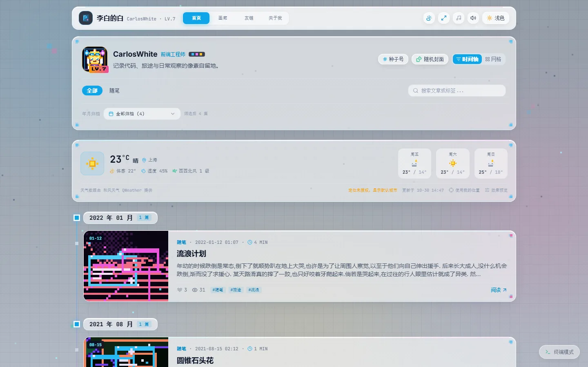
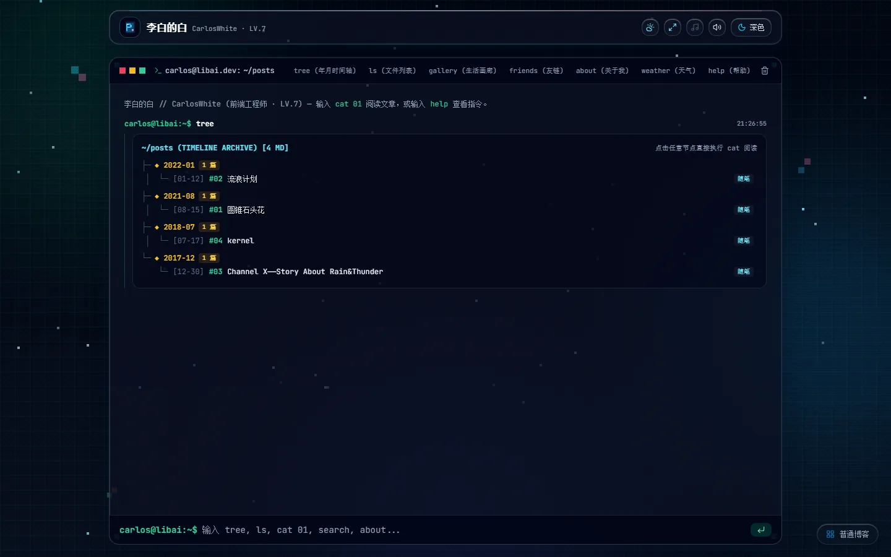
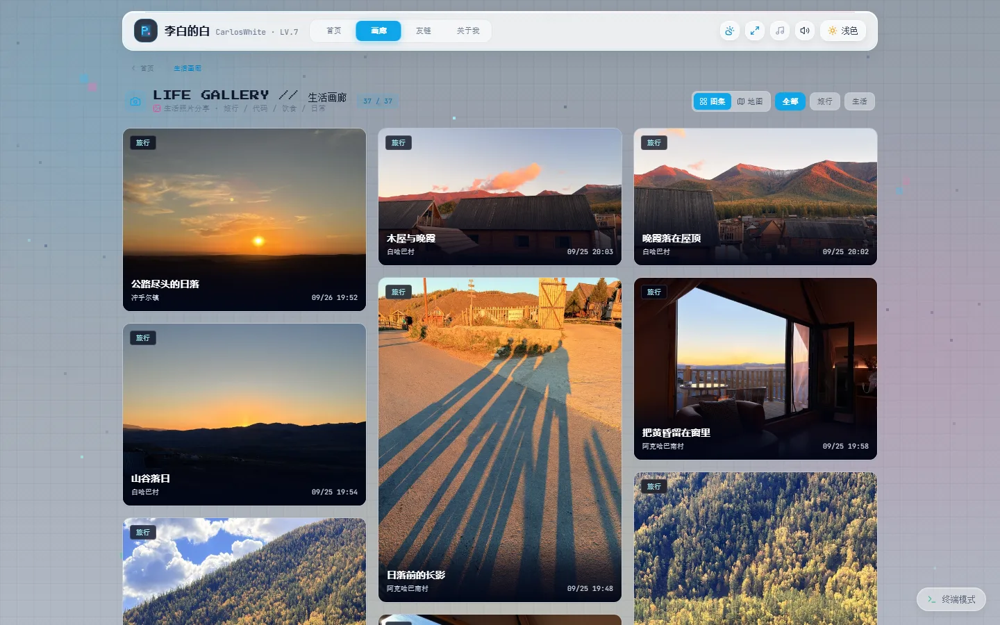
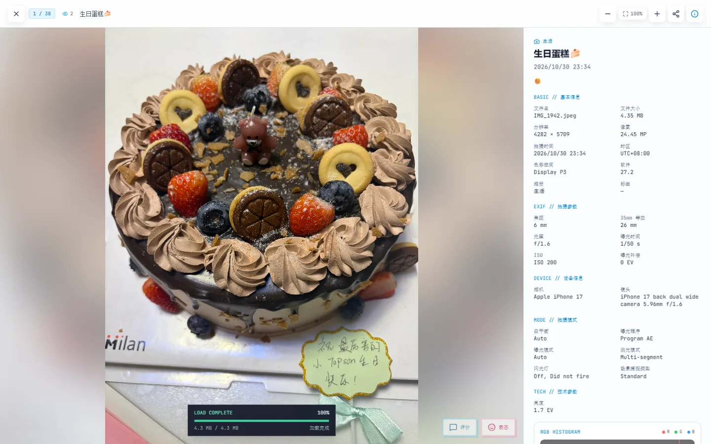
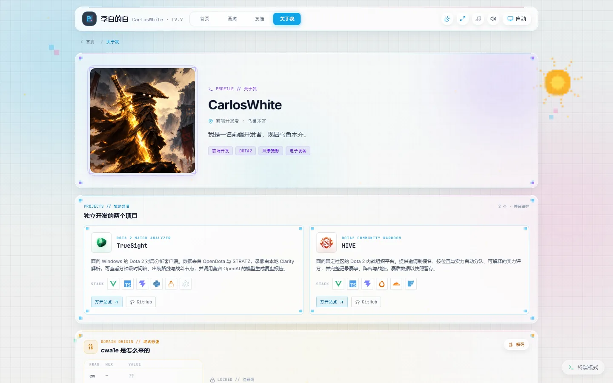
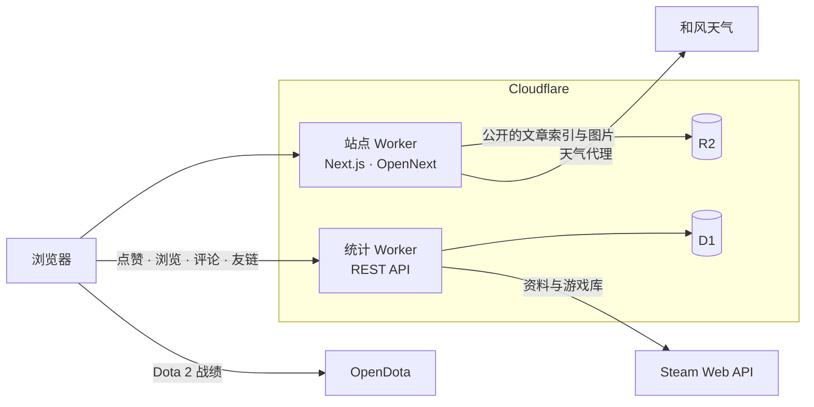

# Pixel Blog

[English](./README.md) · **简体中文**

以像素为骨架、以液态玻璃为皮肤的个人网站——写作、摄影与少量游戏档案，整站从空白画布开始设计，而不是拼装主题。

[站点](https://cwa1e.top) · [画廊](https://cwa1e.top/gallery) · [关于](https://cwa1e.top/about)

[](https://nextjs.org)
[](https://react.dev)
[](https://www.typescriptlang.org)
[](https://tailwindcss.com)
[](https://workers.cloudflare.com)



## 目录

- [项目简介](#项目简介)
- [设计](#设计)
- [界面预览](#界面预览)
- [技术栈](#技术栈)
- [架构](#架构)
- [目录结构](#目录结构)
- [本地运行](#本地运行)
- [命令](#命令)
- [配置](#配置)
- [部署](#部署)
- [已知限制](#已知限制)
- [许可](#许可)
- [致谢](#致谢)

## 项目简介

Pixel Blog 是 CarlosWhite（李白的白）的个人站点，收录三类内容：文字、照片与游戏档案，并用同一套视觉系统呈现——像素网格的结构、液态玻璃的材质，以及跟随真实时间与天气变化的背景。

整站为手写实现：路由、动效规范、照片查看器、终端模式与统计服务均自行设计。没有页面构建器，没有现成主题；除本地上传用的后台之外，也没有在线 CMS。

## 设计

**像素是结构，不是滤镜。** 直角、阶梯状角标与等宽字体标签被当作布局单位使用；圆角只留给需要「软」的表面。

**玻璃是皮肤。** 卡片是半透明的一层——22px 模糊、190% 饱和度、1px 高光边，因此背景流动时，卡片不会变成贴在壁纸上的色块。

**先有光，再有内容。** 背景依据观测点的太阳与月亮位置、月相与风力运行，并叠加雨、雪、雾或雷。内容始终在前景，天气只作环境。

**动效用于解释空间。** 卡片从自身矩形展开为面板——展开 300ms、收回 250ms、内容延迟 120ms 出现——所有「卡片到面板」的过渡复用同一个组件（`PixelBloom`）。

**两种阅读，一套骨架。** 标准模式与终端模式共用路由、数据与应用外壳。终端不是主题，而是同一份内容的另一种读法。

## 界面预览

| 标准模式 | 终端模式 |
| --- | --- |
|  |  |

| 画廊 | 照片查看器 |
| --- | --- |
|  |  |



## 技术栈

| 层次 | 选型 |
| --- | --- |
| 框架 | Next.js 16（App Router）、React 19、TypeScript |
| 样式 | Tailwind CSS 3，自定义液态玻璃与像素工具类 |
| 动效 | CSS 过渡 + 统一的卡片展开组件 |
| 媒体 | Swiper（照片查看器）、Canvas 渲染、sharp / EXIF / HEIC 处理 |
| 地图 | Mapbox GL |
| 托管 | Cloudflare Workers（OpenNext） |
| 数据 | Cloudflare D1（点赞、浏览、评论、友链）、R2（文章与图片） |
| 外部服务 | 和风天气、Steam Web API、OpenDota、Simple Icons |

## 架构



补充说明：

- 站点 Worker 负责页面渲染与天气代理。公开内容（文章索引、图片）通过公开域名从 R2 读取，浏览器端无需任何凭证。
- 统计 Worker 承担 D1 的全部写入，并聚合 Steam 数据，边缘缓存 10 分钟。
- Dota 2 数据在浏览器端获取：OpenDota 对 Cloudflare 的出口 IP 限流，Worker 代理不可用。

## 目录结构

```
pixel-blog/
├─ app/                   # App Router 路由、布局、metadata
│  ├─ (site)/             # 共用应用外壳的公开页面
│  ├─ api/weather/        # 和风天气代理
│  └─ admin/              # 仅本地可用的后台（生产环境不打包）
├─ src/
│  ├─ components/         # 外壳、卡片、弹窗、画廊、天气
│  ├─ lib/                # 数据访问、格式化、互动逻辑
│  ├─ data/               # 画廊元数据、生成的天气快照
│  ├─ hooks/ utils/ types/
│  └─ index.css           # 设计变量与动效工具类
├─ worker/                # 统计 Worker（Cloudflare + D1）与建表脚本
├─ public/                # 静态资源、项目标识
├─ docs/screenshots/      # README 配图
└─ scripts/               # 天气抓取、画廊上传、IndexNow
```

## 本地运行

环境要求：**Node.js 22 及以上**。

```bash
git clone https://github.com/LiBaiQiYu/pixel-blog.git
cd pixel-blog
npm install
cp .env.example .env.local   # 按需填写
npm run dev                  # http://localhost:5173
```

仅浏览与改前端时不需要任何凭证；本地后台（上传照片、编辑文章）需要 R2 相关变量，天气卡片需要 `QWEATHER_*`。

## 命令

| 命令 | 说明 |
| --- | --- |
| `npm run dev` | 开发服务器，端口 5173 |
| `npm run build` | 生产构建（含类型检查） |
| `npm start` | 本地运行生产构建 |
| `npm run cf:build` | 生成 Cloudflare 版（OpenNext） |
| `npm run cf:preview` | 构建后在 Workers 运行时预览 |
| `npm run cf:deploy` | 构建并部署站点 Worker |
| `npm run stats:deploy` | 部署统计 Worker |
| `npm run stats:migrate:reactions` | 执行照片表情迁移 |
| `npm run stats:migrate:friends` | 执行友链迁移 |
| `npm run gallery:meta` | 重新生成画廊元数据 |
| `npm run gallery:upload` | 上传画廊资源到 R2 |
| `npm run seo:indexnow` | 向 IndexNow 提交站点地图 |

## 配置

将 `.env.example` 复制为 `.env.local`。此处只列变量名，切勿提交具体值。

| 变量 | 作用域 | 用途 |
| --- | --- | --- |
| `QWEATHER_API_HOST` `QWEATHER_KID` `QWEATHER_PROJECT_ID` `QWEATHER_DEVELOPER_ID` `QWEATHER_PRIVATE_KEY_PATH` `QWEATHER_LAT` `QWEATHER_LON` `QWEATHER_CITY` `QWEATHER_TIMEZONE` | 服务端 | 天气接口与默认位置 |
| `NEXT_PUBLIC_MAPBOX_ACCESS_TOKEN` | 构建期 | 画廊地图 |
| `NEXT_PUBLIC_STATS_API_URL` | 构建期 | 统计接口地址 |
| `NEXT_PUBLIC_BLOG_IMAGE_BASE_URL` | 构建期 | 图片公开域名 |
| `NEXT_PUBLIC_STEAM_ID` | 构建期 | 用于推导 Dota 账号的 SteamID64 |
| `R2_ACCOUNT_ID` `R2_BUCKET` `R2_ACCESS_KEY_ID` `R2_SECRET_ACCESS_KEY` `R2_PREFIX` | 本地 Node | 后台上传与画廊脚本 |
| `R2_BLOG_PREFIX` | 服务端 | 文章在桶内的前缀 |
| `ADMIN_DEV_TOKEN` | 开发 | 局域网访问后台时的校验口令 |
| `FRIENDS_ADMIN_TOKEN` | Worker Secret | 友链审核接口 |
| `DEV_ALLOWED_ORIGINS` | 开发 | 局域网或隧道访问的额外来源 |

## 部署

站点与统计服务是两个独立的 Worker。

```bash
# 统计 Worker：先跑迁移，再写密钥并部署
npx wrangler secret put STEAM_API_KEY --config worker/wrangler.toml
npm run stats:migrate:reactions
npm run stats:migrate:friends
npm run stats:deploy

# 站点 Worker
npm run cf:deploy
```

- `worker/wrangler.toml` 中保留了 `stats.cwa1e.top` 的自定义域名路由。删除它会导致下次部署时 Cloudflare 丢弃该域名绑定。
- `STEAM_API_KEY` 以 Worker Secret 形式保存，不进入前端产物；`STEAM_ID` 是同一文件中的普通变量。
- 站点 Worker 的 `NEXT_PUBLIC_*` 变量需要在 Cloudflare 的构建环境变量中配置，仅设置运行时变量不够。

## 已知限制

- **没有在线后台与登录体系。** 后台仅限本地，依赖 Node 端的图像处理；生产环境的 `/admin` 返回 404。
- **没有自动化测试。** 目前以生产构建加浏览器人工检查作为验证手段。
- **Steam 徽章与展柜**只存在于社区主页，Web API 不提供，因此档案面板只展示汇总数值。
- **Dota 2 数据**只能走浏览器端：OpenDota 对 Cloudflare Worker 出口 IP 返回 `429`。
- Netlify 与 Vite 相关配置是早期部署目标留下的，当前未使用。

## 许可

站内文字与照片版权归 CarlosWhite 所有。代码公开供参考，未授予开源许可。

## 致谢

- 画廊的理念与部分设计语言来自 [ChronoFrame](https://github.com/HoshinoSuzumi/chronoframe)。
- 天气数据由[和风天气](https://www.qweather.com)提供。
- 游戏数据来自 [Steam Web API](https://steamcommunity.com/dev) 与 [OpenDota](https://www.opendota.com)。
- 技术栈图标来自 [Simple Icons](https://simpleicons.org)（CC0）。
